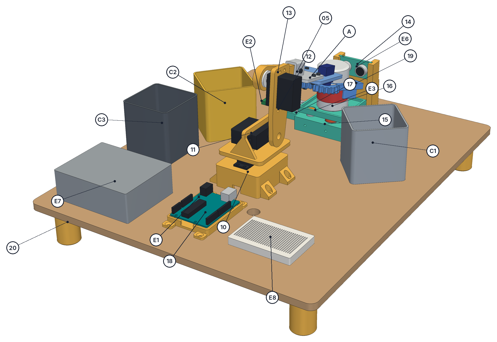
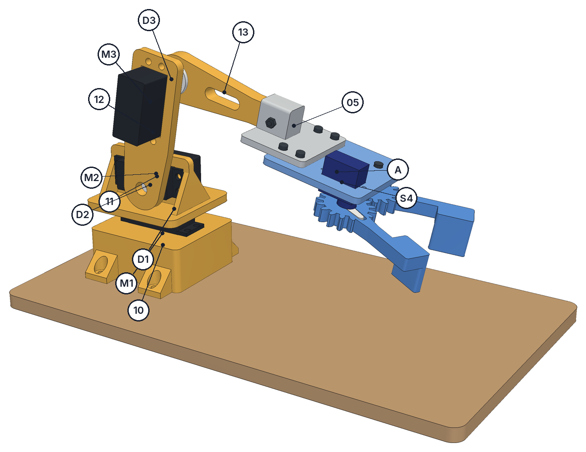
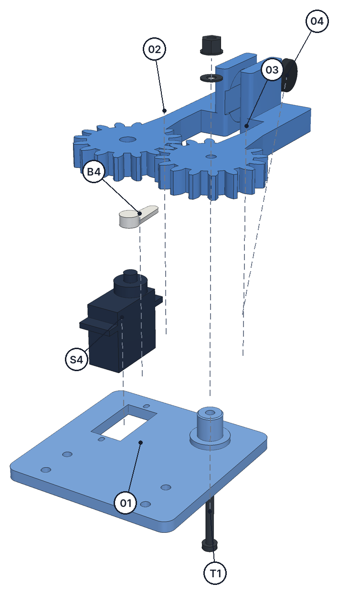
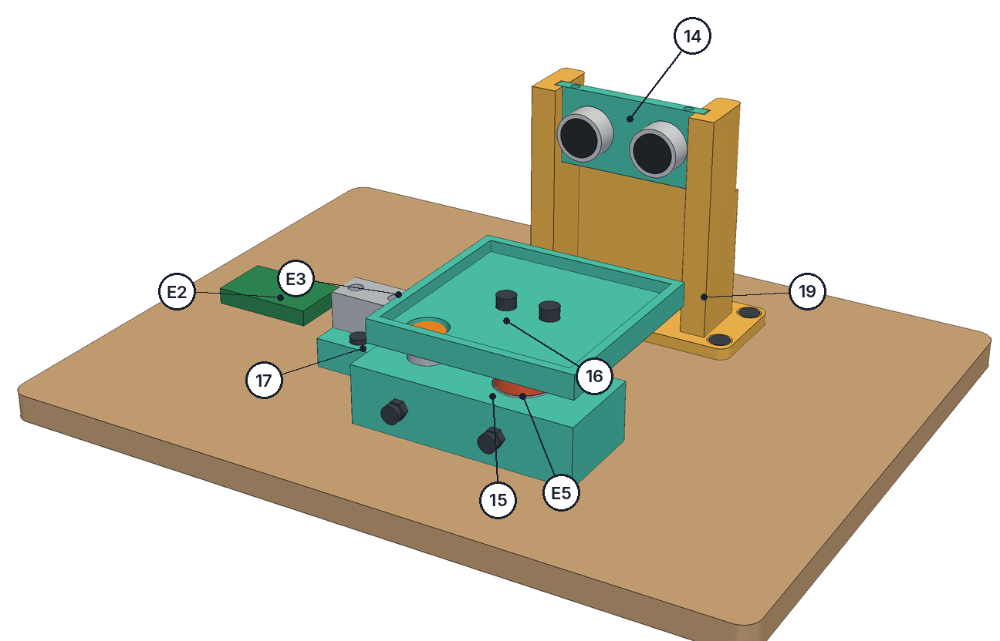

# Modelo 3D · Garra robótica clasificadora SCB



Modelo CAD del prototipo del Proyecto SCB. Incluye:

- el brazo robótico con 3 servos MG996R (base, hombro y codo);
- la pinza, accionada por un servo SG90;
- la estación de sensado: celda de carga, sensores de proximidad inductivo y capacitivo, y HC-SR04;
- el tablero de MDF donde se atornilla todo.

Todas las medidas están en milímetros.

| Brazo v3 | Pinza | Estación de sensado |
|:---:|:---:|:---:|
|  |  |  |

## Contenido

```
modelo_3d/
├── ensamble/
│   ├── Garra_SCB_v3_MG996R.step      brazo + pinza armados, con servos y tornillos
│   └── Prototipo_SCB_completo.step   todo el prototipo sobre el tablero
├── brazo_v3/       piezas 10 a 13 (STL para imprimir y STEP)
├── pinza/          piezas 01 a 07 (STL) y STEP de la pinza y la muñeca
├── estacion/       piezas 14 a 17 y 19 (STL)
├── base/           soporte del Arduino (18) y patas del tablero (20)
├── planos/         planos de armado y lista de materiales (PDF)
├── imagenes/       vistas del modelo
└── fuente/         scripts de CadQuery que generan el modelo
```

## Cómo ver y abrir los archivos

- **En GitHub:** al hacer clic en cualquier `.stl`, GitHub lo muestra en 3D y se puede girar.
- **STEP:** se abren en Fusion 360 (*Archivo → Abrir → Abrir desde mi equipo*), FreeCAD, Onshape o SolidWorks. Los ensambles traen el nombre y el color de cada pieza.
- **Sistema de coordenadas de los ensambles:**
  - El origen está en el eje del servo de la base, sobre la cara superior del tablero.
  - X va hacia la derecha, Y hacia la estación de sensado y Z hacia arriba.
- **STL:** cada pieza viene sola y ya orientada para imprimir, sin soportes.

## Piezas impresas

El número final del nombre del archivo (`_x1`, `_x4`) indica cuántas unidades hay que imprimir.

| Cód. | Pieza | Archivo | Cant. | Medidas (mm) |
|:---:|---|---|:---:|---|
| 10 | Base del brazo (aloja el MG996R de la base) | `brazo_v3/stl/10_base_MG996R_x1.stl` | 1 | 88 × 72 × 30 |
| 11 | Torreta (hombro) | `brazo_v3/stl/11_torreta_MG996R_x1.stl` | 1 | 64 × 72 × 38 |
| 12 | Eslabón del hombro | `brazo_v3/stl/12_eslabon_hombro_MG996R_x1.stl` | 1 | 87,6 × 87,6 × 6 |
| 13 | Antebrazo | `brazo_v3/stl/13_antebrazo_MG996R_x1.stl` | 1 | 99 × 30 × 10 |
| 01 | Chasis de la pinza | `pinza/stl/01_chasis_pinza_x1.stl` | 1 | 65 × 66 × 14,8 |
| 02 | Dedo izquierdo, motriz, con alojamiento para el FSR | `pinza/stl/02_dedo_izquierdo_con_FSR_x1.stl` | 1 | 36 × 80 × 24 |
| 03 | Dedo derecho | `pinza/stl/03_dedo_derecho_x1.stl` | 1 | 35,5 × 79,8 × 24 |
| 04 | Disco del FSR (TPU) | `pinza/stl/04_disco_FSR_x1_TPU.stl` | 1 | Ø12 × 2,5 |
| 05 | Muñeca (une la pinza al antebrazo) | `pinza/stl/05_munieca_x1.stl` | 1 | 52 × 45 × 22,4 |
| 06, 07 | Calces de 0,5 y 1 mm (opcionales) | `pinza/stl/0[67]_calce_*.stl` | — | 8 × 8 |
| 14 | Placa del HC-SR04 | `estacion/stl/14_soporte_HC_SR04_x1.stl` | 1 | 52 × 26 × 4 |
| 15 | Soporte de los sensores de proximidad | `estacion/stl/15_soporte_proximidad_x1.stl` | 1 | 75 × 32 × 20 |
| 16 | Bandeja de pesaje v2, con ventana para el inductivo | `estacion/stl/16_bandeja_v2_x1.stl` | 1 | 70 × 70 × 8 |
| 17 | Soporte fijo de la celda de carga | `estacion/stl/17_soporte_celda_x1.stl` | 1 | 30 × 25 × 10 |
| 19 | Poste del HC-SR04 | `estacion/stl/19_poste_HC_SR04_x1.stl` | 1 | 84 × 34 × 77,7 |
| 18 | Soporte del Arduino UNO | `base/stl/18_soporte_arduino_UNO_x1.stl` | 1 | 94,6 × 59,3 × 9 |
| 20 | Pata del tablero | `base/stl/20_pata_x4.stl` | 4 | 30 × 30 × 50 |

**Parámetros de impresión**

- **Material:** PLA. El disco 04 va en TPU; si no tienen, sirve en PLA o un disco de goma de 11 mm.
- **Capa:** 0,2 mm.
- **Relleno:** 40 % giroide.
- **Perímetros:** 4.
- **Soportes:** ninguna pieza los necesita.

Todas las piezas caben en un volumen de 100 × 100 × 100 mm.

## Componentes que no se imprimen

**Electrónica**

- 3 servos MG996R y 1 servo SG90 (o MG90S)
- Arduino UNO
- Fuente de 5 V y 10 A
- Sensor ultrasónico HC-SR04
- Celda de carga de 1 kg con módulo HX711
- Sensor inductivo LJ12A3-4-Z/BX
- Sensor capacitivo LJC18A3-H-Z/BX
- Sensor de fuerza FSR-402

**Estructura**

- Tablero de MDF de 9 mm, de 400 × 500 mm

La lista completa, con tornillería y para qué sirve cada cosa, está en los planos.

## Planos

| Archivo | Contenido |
|---|---|
| `planos/1_Plano_y_materiales_brazo_v3.pdf` | Armado del brazo v3 paso a paso y lista de materiales del brazo |
| `planos/2_Plano_general_prototipo.pdf` | Conjunto, distribución y perforaciones del tablero, electrónica y lista de materiales completa |
| `planos/3_Plano_armado_estacion_sensado.pdf` | Armado de la estación paso a paso, medidas de control, conexiones, calibración y plantilla 1:1 |

## Regenerar el modelo

Los scripts de `fuente/` generan las piezas con [CadQuery](https://cadquery.readthedocs.io). Para cambiar una medida, edítenla en el script y vuelvan a correrlo. Primero instalen las dependencias:

```bash
pip install -r fuente/requirements.txt
```

Luego corran el script que corresponda:

| Comando | Qué genera | Dónde lo deja |
|---|---|---|
| `cd fuente/brazo_y_prototipo` y luego `python modelo.py` | Brazo v3: ensamble, STL y STEP de las piezas 10 a 13 | `salida/brazo` |
| `python arduino.py` (en la misma carpeta) | Soporte del Arduino (18) | `salida/base` |
| `python proyecto.py` (en la misma carpeta; tarda unos minutos) | Prototipo completo, poste 19, patas 20 y bandeja v2 | `salida/prototipo` |
| `cd fuente/pinza` y luego `python exportar.py` | Pinza (piezas 01 a 04 y calces) | `salida/pinza` |

`fuente/referencia/Robot_SCB_para_Fusion.step` es el modelo anterior del robot. De ahí `modelo.py` y `proyecto.py` toman la pinza, la muñeca y las piezas de la estación.

Al final, `modelo.py` avisa 3 cruces entre cada MG996R y su disco. Es esperado: corresponde al estriado del eje metido en el disco.

La carpeta `salida/` está en `.gitignore`.

## Versiones

| Versión | Cambios |
|---|---|
| Pinza v2 (oct. 2026) | Pinza corregida (piezas 01 a 05) |
| Brazo v3 (nov. 2026) | Brazo rediseñado para 3 servos MG996R (piezas 10 a 13). Reemplaza al brazo con micro servos SG90, que no se incluye |
| Estación y base (nov. 2026) | Bandeja v2 con ventana para el inductivo, poste del HC-SR04 (19), soporte del Arduino (18) y patas (20) |

---

**Proyecto SCB**, Taller de Diseño en Ingeniería, Universidad Adolfo Ibáñez. Profesor: Luís Andueza.

**Equipo:** Facundo Saavedra, Matías Jara y Martín Olivares.
